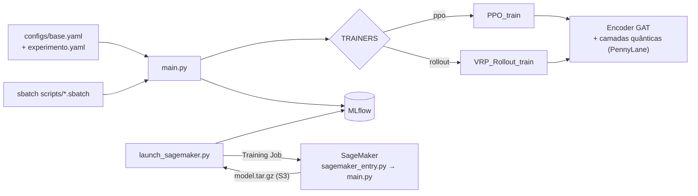

# QGAT VRP Training

Este é um framework de treino e experimentação para **Graph Attention com camadas quânticas híbridas (QGAT)** aplicado ao problema de roteamento de veículos (CVRP). O treino usa aprendizado por reforço (PPO e REINFORCE com rollout baseline). O mesmo código roda localmente, num cluster Slurm ou na AWS SageMaker, e todos os experimentos são rastreados no MLflow.

Foi desenvolvido no Instituto Eldorado, num projeto de P&D em otimização de rotas. O projeto foi descontinuado e o código é publicado aqui com autorização.

## O que este repo mostra

- **Um ponto de entrada para três ambientes.** `main.py` recebe `configs/base.yaml` mais um YAML de experimento. Slurm (`scripts/*.sbatch`) e SageMaker (`sagemaker_entry.py`) chamam a mesma CLI.
- **Lançamento padronizado na AWS.** `launch_sagemaker.py` sobe o Training Job e espera ele terminar. Depois baixa o `model.tar.gz` do S3 e importa os runs no MLflow local. `check_aws_status.py` e `check_billing.py` acompanham o status dos jobs e o custo.
- **Experimentos versionados por configuração.** São 49 YAMLs de baseline, ablação e debug. Eles cobrem ansatz, decoder quântico, FFN, pesos de loss, beam search e distribuição de instâncias. `scripts/generate_ablation_yamls.py` e `submit_ablation_batch.py` geram e submetem essas baterias.
- **Modelo híbrido clássico-quântico.** `src/DRL_Lei/quantum_layers.py` e o ansatz PCE (`ansatz/pce.py`) usam PennyLane. O mesmo modelo pode rodar em modo `--mode classical` para servir de baseline.
- **Testes.** Os testes com pytest cobrem configuração, dados, modelos, camadas quânticas, MLflow, infraestrutura e cenários ponta a ponta. Eles usam os markers `quantum`, `infra` e `scenario`.



## Como rodar

```bash
pip install -e ".[quantum]"            # ou .[quantum-gpu], .[aws]
python main.py --base configs/base.yaml --config configs/debug/light_test.yaml
python main.py --base configs/base.yaml --config configs/debug/light_test.yaml --mode classical
pytest -m "not slow and not infra"
```

Na AWS, as credenciais vêm das variáveis de ambiente `AWS_ACCESS_KEY_ID`, `AWS_SECRET_ACCESS_KEY` e `SAGEMAKER_ROLE_ARN`. Com elas definidas, rode `python launch_sagemaker.py --config configs/baselines/baseline_10k.yaml`.

Veja o `SAGEMAKER_SLURM_GUIDE.md` para os detalhes de cada ambiente.

## Créditos

O pacote `DRL_Lei` parte de uma implementação de DRL para VRP de outro autor. <!-- TODO: link do repositório original --> As instâncias e o roteamento por atenção seguem Kool et al. (2019), *Attention, Learn to Solve Routing Problems!*. As camadas quânticas, a infraestrutura de treino e os experimentos são contribuição do autor deste repositório.
