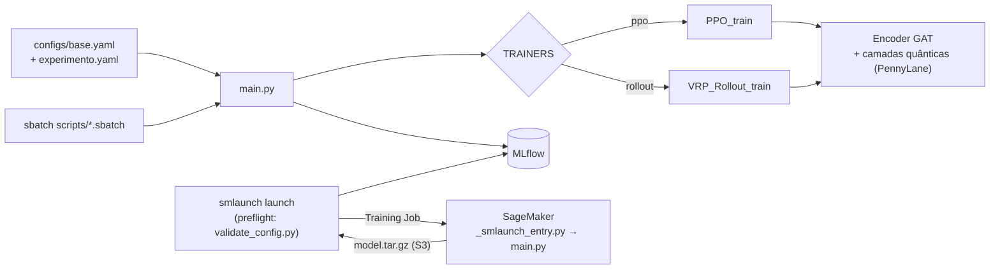

# QGAT VRP Training

Este é um framework de treino e experimentação para **Graph Attention com camadas quânticas híbridas (QGAT)** aplicado ao problema de roteamento de veículos (CVRP). O treino usa aprendizado por reforço (PPO e REINFORCE com rollout baseline). O mesmo código roda localmente, num cluster Slurm ou na AWS SageMaker, e todos os experimentos são rastreados no MLflow.

Foi desenvolvido no Instituto Eldorado, num projeto de P&D em otimização de rotas. O projeto foi descontinuado e o código é publicado aqui com autorização.

> **Paper:** RITT, M. R. P.; DA ROSA JÚNIOR, A. S.; **REBALLO, M. V.**; DO AMARAL, C. A.; DE BARROS, F. A. C. *A hybrid quantum-classical neural network for learning to route*. [arXiv:2609.00489](https://arxiv.org/abs/2609.00489), 2026. Submetido ao CBCTQ 2026.

## O que este repo mostra

- **Um ponto de entrada para três ambientes.** `main.py` recebe `configs/base.yaml` mais um YAML de experimento. Slurm (`scripts/*.sbatch`) e SageMaker (`sagemaker_entry.py`) chamam a mesma CLI.
- **Lançamento padronizado na AWS com o [smlaunch](https://github.com/marcosreballo-source/sagemaker-training-launcher).** Eu extraí esse framework deste projeto. O `smlaunch.yaml` descreve o job, o preflight roda `validate_config.py` antes de qualquer gasto e o hook `smlaunch_naming.py` codifica método, baseline, critic e topologia quântica no nome do job. No fim, o smlaunch baixa os checkpoints e importa os runs no MLflow local. Os scripts `launch_sagemaker.py`, `sagemaker_entry.py` e `check_*.py` são a primeira versão desse pipeline e ficaram como histórico.
- **Experimentos versionados por configuração.** São 49 YAMLs de baseline, ablação e debug. Eles cobrem ansatz, decoder quântico, FFN, pesos de loss, beam search e distribuição de instâncias. `scripts/generate_ablation_yamls.py` e `submit_ablation_batch.py` geram e submetem essas baterias.
- **Modelo híbrido clássico-quântico.** `src/DRL_Lei/quantum_layers.py` e o ansatz PCE (`ansatz/pce.py`) usam PennyLane. O mesmo modelo pode rodar em modo `--mode classical` para servir de baseline.
- **Testes.** Os testes com pytest cobrem configuração, dados, modelos, camadas quânticas, MLflow, infraestrutura e cenários ponta a ponta. Eles usam os markers `quantum`, `infra` e `scenario`.



## Como rodar

```bash
pip install -e ".[quantum]"            # ou .[quantum-gpu], .[aws]
python main.py --base configs/base.yaml --config configs/debug/light_test.yaml
python main.py --base configs/base.yaml --config configs/debug/light_test.yaml --mode classical
pytest -m "not slow and not infra"
```

Para rodar na AWS, as credenciais vêm da cadeia padrão do boto3 (perfil, SSO ou variáveis de ambiente) e a role vem de `SAGEMAKER_ROLE_ARN`:

```bash
pip install "smlaunch[sagemaker]"
smlaunch launch --dry-run --var config=configs/baselines/baseline_10k.yaml   # plano + validação, sem custo
smlaunch launch --var config=configs/baselines/baseline_10k.yaml             # lança, acompanha e baixa
smlaunch audit && smlaunch cost --tag Project                                # nada esquecido ligado? quanto custou?
```

Veja o `SAGEMAKER_SLURM_GUIDE.md` para os detalhes de cada ambiente.

## Créditos

O pacote `DRL_Lei` partiu da implementação de referência de LEI, K. et al. (2022), *Solve routing problems with a residual edge-graph attention neural network* (Neurocomputing, v. 508, p. 79–98; [arXiv:2105.02730](https://arxiv.org/abs/2105.02730); [código original](https://github.com/Lei-Kun/DRL-and-graph-neural-network-for-routing-problems)). O código foi fortemente modificado desde então. As mudanças incluem:

- camadas quânticas híbridas e ansatz PCE;
- configuração unificada em YAML;
- trainers PPO e rollout;
- beam search, critics e avaliação;
- integração com o MLflow;
- execução em Slurm e SageMaker.

A geração de instâncias segue Kool et al. (2019), *Attention, Learn to Solve Routing Problems!*.
